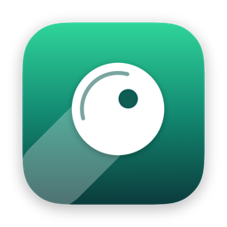
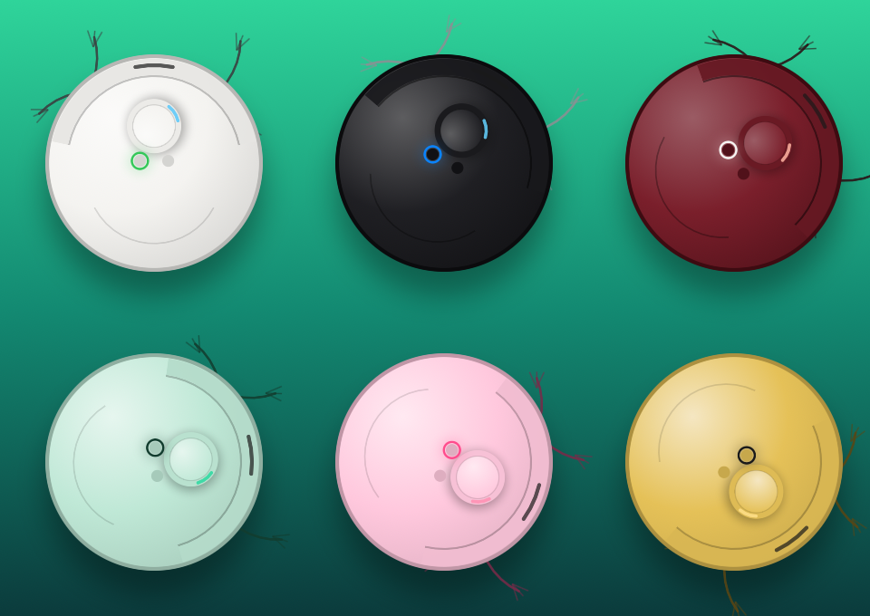
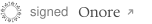

<p align="center">
  
</p>

<h1 align="center">DeskVac</h1>

<p align="center"><b>A robot vacuum for your Mac desktop.</b><br>
It scans the clutter, drives over to every file and sorts it into folders. Nothing is ever deleted.</p>

<p align="center"><a href="#türkçe">Türkçe</a> · <a href="#install">Install</a> · <a href="#how-it-works">How it works</a></p>

<p align="center"></p>

## What it does

- **Scans your desktop** with a LiDAR-style sweep and labels every icon: `screenshot · 2.1 MB`, `folder · 12 items`, `protected`.
- **Drives to the real icons.** It asks Finder where each icon sits, rolls over and swallows them one by one, with speech bubbles ("nom!", "So many screenshots…", "I'm stuck!").
- **Sorts by type** into `Desktop Archive/Screenshots`, `Images`, `PDFs`, `Documents`, `Archives`, `Installers`, `Code`, `Videos`, `Audio`, `Other`. Optionally per month, or as folders right on the desktop.
- **You decide per type:** Tidy, Trash or Leave. Trash only screenshots, or only `.dmg` and `.pkg`, or only files older than 30 days.
- **Review what went to the Trash.** The result card lists every trashed file: restore any of them, or delete them for good after a confirm.
- **Folders too, if you want** (off by default): loose folders move into `Desktop Archive/Folders`. Git repositories and apps never move.
- **Undoable.** Nothing is deleted unless you pick Trash, and even then it sits in the Trash. Every move is written to a journal as it happens. One click puts every file back, even at its old icon position.
- **Leaves things alone:** apps, shortcuts, git repositories, hidden files, downloads still in progress, files changed in the last few minutes, and anything with a protection word (`DONT DELETE`, `KEEP`, `SİLME`…) in its name or Finder tags.
- **Parks on its dock** in the corner between cleans if you like. Click it and it sets off again.
- **Make it yours:** six presets plus body, light, scanner and brush colors, size, speed and name. Motor sound is synthesized live.
- **Runs on its own** every day at a set hour, or when the desktop piles up past a number of files.
- **English and Turkish**, switchable in Settings.

## Install

**Download:** grab `DeskVac.zip` from [Releases](https://github.com/morphmind/deskvac/releases), unzip and move `DeskVac.app` to Applications. The app is signed with Developer ID and notarized by Apple, so it opens with a double-click.

**Build from source** (macOS 15+, Xcode 16+ command line tools):

```sh
git clone https://github.com/morphmind/deskvac.git
cd deskvac
./build.sh --install
```

`build.sh` uses plain `swiftc`, no Xcode project. It runs the string check and the file-safety self test on every build, draws the app icon from code, and signs with your Developer ID or Apple Development certificate, or ad-hoc if you have none. `./build.sh --notarize` also notarizes and staples the app (needs a `notarytool` keychain profile, `NOTARY_PROFILE`, default `deskvac-notary`).

On the first clean macOS asks for two permissions: **Desktop folder** (to move files) and **Finder automation** (to read icon positions). Without the second one the robot still tidies, it just can't drive to the exact icons.

## Use it

Click the robot icon in the menu bar:

| | |
|---|---|
| **Clean desktop** (⌘K) | Scan, confirm, pick everything up |
| **Scan only** | See what would be tidied, touch nothing |
| **Undo last clean** | Put every file back |
| **Review trashed files** | Restore or delete for good what went to the Trash |
| **Make a demo mess** | Drop 25 fake, tagged files on the desktop for a try or a video |
| **Settings…** | Robot look, cleaning rules, schedule, language |

## Recording a video

1. Settings > General: turn on **Only pick up demo files**, so your real files stay put.
2. Settings > Robot: turn on **Drive above windows** if you can't hide every window.
3. Start your screen recording, then run:

```sh
open -a DeskVac --args --demo --clean
```

`--demo` spreads a believable mess across the desktop, `--clean` starts the robot a few seconds later. Use **Remove demo files** afterwards; it only ever deletes files DeskVac tagged itself.

## How it works

- `Scanner.swift` lists the folder, classifies each file by extension and Spotlight's screen capture flag, applies the protection rules and reads icon positions from Finder over Apple Events.
- `Mover.swift` moves files with `FileManager.moveItem` (same volume, so it's an instant rename), renames on a clash like Finder does (`photo 2.jpg`) and writes a JSON journal to `~/Library/Application Support/DeskVac/journals` after every single move.
- `Scene.swift` is a transparent window one level above the desktop icons. A timer advances the robot, a SwiftUI `Canvas` paints it. Real Finder thumbnails are swapped in for the icons the moment a file moves, so the pickup looks seamless.
- `RobotPainter.swift` draws the robot in code, no image assets.
- `SelfTest.swift` builds a fake desktop in a temp folder and checks scan rules, clashes, protection and undo. `./build.sh` fails if any of it breaks.

DeskVac has no network code and collects nothing.

## Contributing

Issues and pull requests are welcome. New languages: add a table to `Sources/L10n.swift` with the same keys; `--check-strings` tells you what's missing.

---

## Türkçe

**Mac masaüstünüz için robot süpürge.** Dağınıklığı tarar, her dosyanın yanına gider ve türüne göre klasörlere toplar. Hiçbir şeyi silmez.

- **Tarar:** lidar benzeri taramayla her ikonu etiketler (`ekran görüntüsü · 2,1 MB`, `klasör · 12 öğe`, `korunuyor`).
- **Gerçek ikonlara gider:** ikonların yerini Finder'dan öğrenir, tek tek yutar, konuşma balonlarıyla ("nom!", "Ne çok ekran görüntüsü…", "Takıldım!").
- **Türlere ayırır:** `Masaüstü Arşivi/Ekran Görüntüleri`, `Görseller`, `PDF`, `Belgeler` gibi. İsterseniz aylara böler ya da klasörleri doğrudan masaüstüne açar.
- **Tür başına karar:** Topla, Çöpe at ya da Dokunma. Yalnız ekran görüntülerini, yalnız `.dmg`/`.pkg` dosyalarını ya da yalnız 30 günden eskileri çöpe atabilirsiniz.
- **Çöpe gidenleri gözden geçirin:** sonuç kartı çöpe atılan her dosyayı listeler; istediğinizi geri getirin ya da onaydan sonra kalıcı silin.
- **İsterseniz klasörler de** (varsayılan kapalı): dağınık klasörler `Masaüstü Arşivi/Klasörler` altına gider. Git depoları ve uygulamalar hiç taşınmaz.
- **Her şey geri alınır:** her taşıma anında günlüğe yazılır. Tek tıkla bütün dosyalar eski yerine, ikonlar eski konumuna döner.
- **Dokunmadıkları:** uygulamalar, kısayollar, git depoları, gizli dosyalar, inmekte olan dosyalar, son dakikalarda değişen dosyalar, adında ya da Finder etiketinde koruma kelimesi (`SİLME`, `SAKLA`, `DONT DELETE`…) geçenler.
- **Şarjında bekler:** isterseniz temizlikler arasında köşedeki istasyonunda durur, üstüne tıklayınca yeniden çalışır.
- **Kişiselleştirme:** altı hazır renk, gövde/ışık/tarayıcı/fırça renkleri, boyut, hız ve ad.
- **Zamanlama:** her gün belli saatte ya da masaüstünde belli sayıda dosya birikince kendiliğinden çıkar.

**Kurulum:** [Releases](https://github.com/morphmind/deskvac/releases) sayfasından `DeskVac.zip` dosyasını indirip uygulamayı Uygulamalar klasörüne taşıyın. Uygulama Developer ID ile imzalı ve Apple tarafından onaylı (notarized), çift tıklayınca açılır. Kaynaktan derlemek için `./build.sh --install`.

**Video çekmek için:** Ayarlar > Genel'de **Yalnız demo dosyalarını topla**'yı açın, kaydı başlatıp `open -a DeskVac --args --demo --clean` komutunu çalıştırın. Gerçek dosyalarınıza dokunulmaz.

---

<p align="center">MIT License</p>
<p align="center">
  <a href="https://onore.io">
    <picture>
      <source media="(prefers-color-scheme: dark)" srcset="docs/onore-dark.svg">
      
    </picture>
  </a>
</p>
